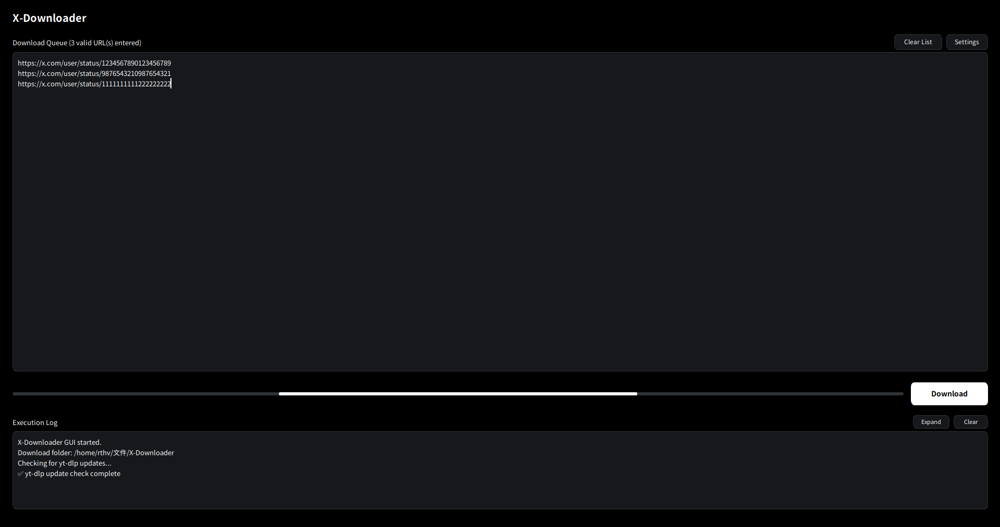
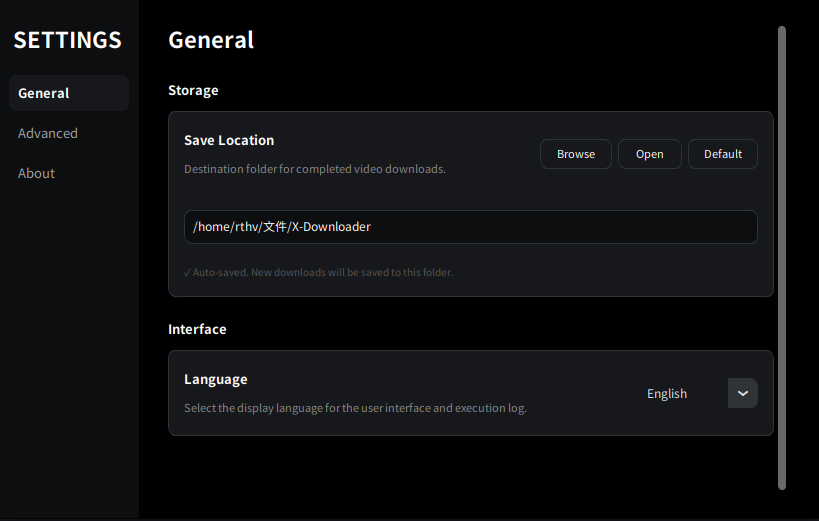
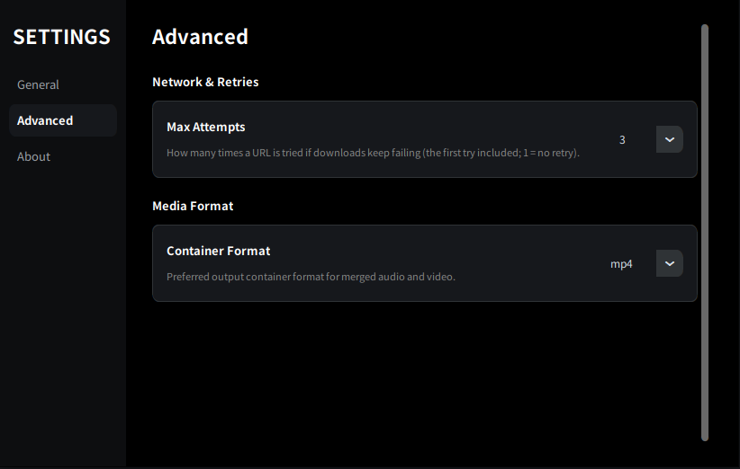

# X-Downloader

X-Downloader is a Linux desktop app that downloads the videos in X (Twitter) posts in batches,
at the highest available resolution, and saves them as MP4 (or MKV) files.
It is built on [yt-dlp](https://github.com/yt-dlp/yt-dlp).



The main window, top to bottom: the **Download Queue** (here with three example URLs) with its **Clear List** and
**Settings** buttons, the **Download** button with a bar beside it, and the **Execution Log** with its **Expand** and
**Clear** buttons. Every control is explained under [Using the window](#using-the-window).

---

## Core Features

| Feature | Description |
|---|---|
| **📦 Nothing to Install** | The project brings its own Python and Tk: download it and run it. No root access, no package manager. |
| **🖥️ Modern GUI** | Dark-themed desktop app — paste URLs, manage your queue, and watch real-time logs without touching a terminal. |
| **🔄 Crash-proof Resume** | Unfinished tasks are atomically persisted to `.processing.list`. Even after a crash or power loss, they are put back into the queue on the next launch (press Download to continue). |
| **📋 Double Buffer Queue** | A batch reads its queue from `.processing.list` while `list.txt` is released immediately, so a URL that a script appends to `list.txt` during a batch is kept for the next round. `list.txt` is the GUI's own saved list, though: while the window is open, edit the list in the window, not the file (see the FAQ). |
| **🔁 Smart Retry & Error Isolation** | Each URL is tried up to 3 times in total (the first try plus 2 retries, 5 s apart; change it under Settings → Advanced → Max Attempts). Errors that retrying cannot fix are not retried. If the network is down (3 URLs in a row fail that way), the batch stops and those URLs stay in the list instead of ending up in `failed_list.txt`. On failure, the URL is appended to `failed_list.txt` without blocking the remaining downloads. |
| **🔒 Single Instance Protection** | OS-level file lock (`flock`) prevents duplicate processes from corrupting files. |
| **⬆️ Auto-update yt-dlp** | Checks for yt-dlp updates once at GUI startup, in the background (Download is enabled when it finishes), to keep downloads working. |
| **🛡️ Argument Injection Protection** | The `--` separator ends yt-dlp's option parsing, so nothing in the URL list can be read as an option (for example `--exec`). |
| **💾 Atomic Writes** | Queue updates use "write-to-temp, then atomic replace" — `.processing.list` is never zeroed out mid-write. |
| **🔌 Extensible Config & Hooks** | Sites, languages, download settings and post-download hooks each have a documented extension point: see [How to extend](#how-to-extend). |

---

## Requirements

**Nothing has to be installed.** Download the project from GitHub and start it: it brings its own Python and Tk, and
needs no root access. `yt-dlp` and FFmpeg are fetched into the project folder the first time you press **Download**
(about 200 MB, once): yt-dlp from its [nightly builds](https://github.com/yt-dlp/yt-dlp-nightly-builds), FFmpeg from the
[BtbN/FFmpeg-Builds](https://github.com/BtbN/FFmpeg-Builds) project (a GPL build of FFmpeg's master branch). Each
download is checked against the SHA-256 checksums that its project publishes next to it, and is not installed if they do
not match.

- **Linux on x86_64 or aarch64** with a graphical session: X11, or Wayland with XWayland. Windows and macOS are not
  supported: the program relies on `/proc` and on Linux builds of the bundled runtime, yt-dlp and ffmpeg.
- **Chinese text** (the Traditional Chinese interface you can switch to; English is the default) needs a Chinese font
  on the system, which any desktop set up for Chinese has.
- **A project folder that can run programs**: not on a `noexec` disk (some USB sticks and shared partitions), and with
  no colon (`:`) anywhere in its path. The launch script says so when one of these is the problem; moving the project to
  your home folder fixes both.
- **Other CPUs** (32-bit x86 or ARM, RISC-V, ...) have no bundled runtime: install Python 3.10+, tkinter,
  `customtkinter` and `ffmpeg` yourself, and the same launch script uses them.

The launch script prints its messages in Traditional Chinese. For a colon in the path, a `noexec` disk or an
unsupported CPU it says "路徑含有冒號", "不允許執行程式" or "沒有內附的執行環境" respectively.

Tested in plain distribution images with only fonts added, as a normal user, through to a merged video and the full test
suite: Ubuntu 20.04, 22.04, 24.04 and 26.04, Debian 11, 12 and 13, Kali, Fedora 45, AlmaLinux 10, Rocky Linux 9,
openEuler 24.03, Mageia 9, openSUSE Tumbleweed and Leap 15.6 / 16.0, Arch, Manjaro, Void, Gentoo, Alpine and the
`nixos/nix` image. On a real Linux Mint 22 desktop, the window and the full test suite were tested, but not a download.
On aarch64 the bundle has only been run under emulation, up to the main window.

---

## Usage

### Step 1: Log into X (cookies)

This tool needs your X (Twitter) session cookie to access restricted videos. Anyone who has that cookie can use your
account: see the [Security Warning](#security-warning).

> ⚠️ **Account risk:** X's [Terms of Service](https://x.com/en/tos) forbid accessing X by automated means other than
> through X's published interfaces, and X may suspend the account of anyone who breaks them. This tool is not one of
> those interfaces, so it can get the account you log in with suspended: use an account you can afford to lose.

**Recommended:** simply log into x.com in Firefox, Chrome, Chromium, Brave, Opera, Edge or Vivaldi.
The downloader finds the browser profile that holds the login automatically (Firefox: classic, XDG
`~/.config/mozilla/firefox`, Snap and Flatpak locations are supported).

**Alternative:** provide a `cookies.txt` in **Netscape HTTP Cookie** format (must contain `auth_token` and `ct0`).

**Browser extensions for export** (examples, not endorsements):
- Chrome: [Get cookies.txt LOCALLY](https://chromewebstore.google.com/detail/get-cookiestxt-locally/cclelndahbckbenkjhflpdbgdldlbecc)
- Firefox: [cookies.txt](https://addons.mozilla.org/en-US/firefox/addon/cookies-txt/)

Such an extension can read your browser's cookies, that is, your logins: install one only if you trust it.

Export the file, name it `cookies.txt`, and place it in the project root. Then remove the extension again.

### Step 2: Launch the GUI

```bash
sh start_gui.sh
```

The first start takes a few seconds longer while the bundled runtime is unpacked.
If the window does not appear, the script shows why (its own messages are in Traditional Chinese); the full text is
in `gui_startup.log`.

### Step 3: Download

1. Paste X tweet URLs into the queue box (one per line; right-click → **Paste URL** also works).
   A URL pasted twice is downloaded once; tracking suffixes (`?s=20`, `/video/1`, ...) do not make it a different URL.
2. Click **Download**. While it runs the same button reads **Stop**: it ends the current download and puts every
   unfinished URL back into the list.
3. Watch progress in the real-time log panel (expandable to a separate window).

### Step 4: View results

- **Success**: Videos saved in the download folder (the project root unless you
  [choose another one](#choosing-another-download-folder)) as `UploaderName_TweetTitle_ID.mp4`, or `.mkv` if you
  [picked that container](#using-the-window) (the ID keeps names unique).
- **Failure**: Failed URLs recorded in `failed_list.txt`. Paste them back into the queue to retry.
- **Logs**: Full details in `downloader.log`.

### Using the window

Main window:

- Queue box: one URL per line. The header counts the valid ones ("Download Queue (N valid URL(s) entered)"): links to
  X posts, broadcasts and Spaces, and `t.co` short links; X's home page or a profile page does not count. Other lines
  (a note, a link to another site) are not downloaded and stay in the box. The queue is saved to `list.txt` as shown
  when you close the window and loaded again on the next start.
- Right-click the queue box for **Paste URL** and **Clear List**; the **Clear List** button empties the box too.
- **Settings** opens the Settings window (below).
- **Download** and **Stop** are the same button (Step 3). While yt-dlp is checked for updates at startup it reads
  **Checking for Updates...** and cannot be pressed. The bar beside the button moves while a download runs.
- **Execution Log** shows what the program is doing. **Expand** opens it in a window of its own; **Clear** empties
  the panel (`downloader.log` keeps everything).
- While a download runs, the queue box, **Clear List** and **Settings** are locked. Closing the window then asks for
  confirmation, and if you confirm, the unfinished URLs come back on the next start.

Settings window (changes take effect at once and are saved to `settings.json`):

- **General → Language**: English or 繁體中文. The interface and the execution log switch immediately.
- **General → Save Location**: see [Choosing another download folder](#choosing-another-download-folder). **Open** opens
  the folder in your file manager (`xdg-open`); **Default** goes back to the project folder.
- **Advanced → Max Attempts**: 1, 2, 3 (default) or 5 tries per URL, the first try included (1 = no retry).
- **Advanced → Container Format**: `mp4` (default) or `mkv` for new downloads; the FAQ explains what happens to videos
  you already have.
- **About**: the version, and the state of **yt-dlp Engine** and **FFmpeg Converter**: **Ready** means the `yt-dlp` or
  `ffmpeg` file is in the project folder, **Missing** that it is not (both are missing until the first download).
- A Settings window that is still open when a download starts refuses changes to **Save Location**, **Max Attempts**
  and **Container Format** with a notice; **Language** can still be changed.



The **General** tab: **Save Location** with its path box and the **Browse**, **Open** and **Default** buttons, and
**Language** as a drop-down list. The sidebar on the left lists **General**, **Advanced** and **About**.



The **Advanced** tab: **Max Attempts** and **Container Format**, each a drop-down list.

### Choosing another download folder

**Settings → General → Save Location** (Browse, or type a path). A typed path is trimmed, and `~` and `$HOME`-style
variables in it are expanded like in a shell; a folder picked with Browse is taken exactly as it is.

- The folder must be writable: `/etc`, a read-only folder and the like are refused with the reason. It is checked again
  when a batch starts, so a folder that became unusable stops the batch at once and your URLs stay in the list.
- A folder yt-dlp would not honor is refused too: when you pick one whose own name contains `$VARIABLE` text or ends
  with a space, or whose name is not valid UTF-8 (typically garbled names from Windows archives; rename the folder).
- A folder that does not exist yet is created when you press **Enter**, use **Browse**, close the Settings window,
  switch tabs or start a download; merely clicking elsewhere only shows a hint.
- If the saved folder is missing at startup (external drive not connected), the project folder is used for this run and
  your choice is kept in `settings.json` until you pick another folder.
- The project folder itself (the default) is saved as an empty `download_dir`, not as a path: a copied, moved or renamed
  project folder keeps downloading into itself.

---

## Security Warning

> ⚠️ **`cookies.txt` contains your X account session token. Anyone with this file can access your account.**

- **NEVER** upload `cookies.txt` to GitHub or any public platform.
- **NEVER** share this file with anyone.
- `.gitignore` is an **allow-list**: only the project's own files can be added to Git, so a cookie export under any name
  (`x.com_cookies.txt`, `my-cookies.json`, ...) is ignored, and so is everything else nobody listed.
- A second guard looks at the **content**: `tools/check-secrets.sh` refuses a commit or a push that contains a cookie
  export, an `auth_token` / `ct0` value or a private key, whatever the file is called. It also catches `git add -f` and
  a login pasted into a source file. Binary files are refused as well (a browser's cookie database is one), except the
  runtime bundles `bundled-runtime/linux-*.tar.gz` and the screenshots in `docs/images/*.png`. Enable it once per clone,
  before your first commit:

  ```bash
  git config core.hooksPath tools/githooks
  ```

  The tests (`tests/test_secret_guard.py`) run the same check on every tracked file and run both hooks in a throwaway
  repository. Skipping the hooks on purpose takes `--no-verify`, and GitHub's web upload never runs them.
- **Short links** (`https://t.co/...`) can lead to any website, not only to X: yt-dlp follows them as they are. When the
  cookies come from Chrome, Chromium, Brave, Opera, Edge or Vivaldi, yt-dlp holds all of that browser's cookies, so on
  that website it is logged in as you, as your browser would be (each cookie still goes only to its own website). From
  Firefox it gets X's cookies only: the program copies them for each download into a private temporary folder (in
  `$XDG_RUNTIME_DIR`, or in the temporary folder where that is not set) and deletes the copy when the download ends.
  Paste short links only from sources you trust; when in doubt, open the link in the browser first and paste the X
  address it leads to.

---

## FAQ

**Q: "Another instance is already running"?**

Check for leftover processes of the program (`pgrep -af xdownloader`). A stale `downloader.lock` file alone does not
block startup.

**Q: "Cannot use the lock file" or "Cannot use the log file"?**

`downloader.lock` or `downloader.log` is owned by another user, or the folder is read-only. The usual cause is starting
the app once with `sudo`, which leaves files owned by root. Give the folder back to yourself with
`sudo chown -R "$USER" .` (run it in the project folder), or delete the two files
(`sudo rm downloader.lock downloader.log`).

**Q: Why did a line disappear when I edited `list.txt` while the window was open?**

The window owns `list.txt`: it loads the file once at start and writes its list back on **Download** and on close. A
line that was added to the file but is not in the window when you press **Download** is dropped, and a line appended in
the few milliseconds while the file is rewritten (start and end of a batch) can be lost. Add URLs in the window;
appending to the file from a script is only reliable in the middle of a batch.

**Q: Why do URLs end up in `failed_list.txt`?**

The reason is in `downloader.log` (and the log panel), on the lines marked `yt-dlp:`. Common causes:

1. Log into x.com again in your browser (or re-export `cookies.txt`) — your session may have expired.
2. The post was deleted or has no video (open it in a browser to check).
3. Confirm the URL starts with `https://x.com/`, `https://twitter.com/` or `https://t.co/`.
4. Some accounts restrict video access by privacy settings.

**Q: Why won't the GUI start?**

```bash
sh start_gui.sh   # then read gui_startup.log
# or manually:
.runtime/$(uname -m)/bin/python -m xdownloader
```

The usual cause is a session without an X server: Tk needs X11 or XWayland (GNOME and KDE start XWayland by themselves;
a few Wayland compositors need it switched on).

**Q: Why does my yt-dlp configuration file (`~/.config/yt-dlp/config`, `yt-dlp.conf`) have no effect?**

On purpose: the program starts yt-dlp with `--ignore-config`. Otherwise yt-dlp would also read a `yt-dlp.conf` that sits
in the download folder, and a folder that other people can write to (a shared drive, a synced folder) could change what
yt-dlp does. Put options in `Config` (`config.py`) instead.

**Q: Why are downloads slow?**

Speed depends on your connection, and X may rate-limit requests. The built-in retry mechanism handles transient
failures automatically. Downloads are one at a time, so a long list simply takes longer; a failing URL never blocks
the ones after it.

**Q: I switched the [container format](#using-the-window) (mp4 ↔ mkv). What happens to videos I already have?**

The switch only affects new downloads; it is lossless (the video and audio streams are copied, not re-encoded). For a
tweet whose file already exists in the *other* format, yt-dlp currently behaves differently depending on the direction:

- mp4 → mkv: nothing is downloaded again; the existing `.mp4` is converted to `.mkv` and the `.mp4` is removed.
- mkv → mp4: the video is downloaded again and both the `.mkv` and the new `.mp4` stay in the folder.

That is the usual case, a single video file. A video that yt-dlp has to assemble from separate video and audio streams
is downloaded again in both directions, and both files stay.

---

## Project Structure

```
X-Downloader/
├── xdownloader/        # The program (python3 -m xdownloader); each module is described under Architecture
│   ├── config.py
│   ├── sites.py
│   ├── fsutil.py
│   ├── system.py
│   ├── cookies.py
│   ├── env.py
│   ├── core.py
│   ├── i18n.py
│   └── gui.py
├── start_gui.sh        # Linux launch script (installs nothing)
├── bundled-runtime/    # The bundled Python and Tk, one archive per CPU (see bundled-runtime/README.md)
├── tools/              # build-runtime.sh rebuilds those archives; check-secrets.sh and githooks/ keep logins out of Git
├── requirements.txt    # Python packages that go into the bundled runtime
├── .gitignore          # An allow-list: only the listed kinds of file can be added to Git
├── tests/              # Offline test suite (backend + GUI), see "Testing"
├── docs/               # The screenshots shown in this README (docs/images/)
├── LICENSE             # GNU General Public License, version 3
├── .worktreeinclude    # Git-ignored files to copy into a new git worktree
├── cookies.txt         # Optional: X login cookies (only needed if no browser is logged in)
├── list.txt            # Tweet URLs to download
├── yt-dlp              # yt-dlp binary (auto-downloaded on first run)
├── ffmpeg              # FFmpeg binary (auto-downloaded on first run)
└── README.md           # This document
```

Auto-generated at runtime:

```
├── .runtime/           # The unpacked runtime (written by the launch script on the first start)
├── settings.json       # Persistent user settings (download_dir, max_retries, merge_format, language)
├── .processing.list    # Active download queue (internal)
├── downloader.lock     # Exclusive lock file (auto-deleted on exit)
├── downloader.log      # Full execution log (with tracebacks)
├── failed_list.txt     # Failed URLs (one per line)
└── gui_startup.log     # GUI startup errors (written by the launch script)
```

---

## Architecture

Dependencies only point downwards: `gui → (core, i18n) → (cookies, env) → (sites, system) → config → fsutil`.
The backend never imports the GUI, so it can be driven or tested without a display.

The program runs on the bundled runtime, not on the system's Python: `bundled-runtime/README.md` explains what is in it
and how to rebuild it. It carries its own C library, so yt-dlp, ffmpeg and the other programs it starts are the only
link to the host; they must never inherit a plain `LD_LIBRARY_PATH` (see `_LOADER_SCRIPT` in `env.py`), nor the bundle's
CA list and Tcl/Tk paths that `bin/python` exports for itself (`system.host_env()` removes them).

| Module | Responsibility |
|---|---|
| `fsutil.py` | `atomic_write_text()` (temp file + fsync + replace), `remove_stale_temp_files()` (deletes what a killed write left behind), `folder_problem()` (why a folder cannot be the download folder: unusable name, or nothing can be created in it). No dependency on the rest of the package. |
| `config.py` | `Config`: paths, retries, timeouts, language, yt-dlp format/output template, tool URLs, `settings.json` persistence. |
| `sites.py` | `Site` (URL prefixes, cookie domains, login cookie, non-retryable errors), `extract_urls()`, `normalize_url()`. |
| `system.py` | `ProcessManager` (tracks/kills child process groups), `LockManager` (flock single instance), `QueueManager` (`.processing.list` resume), `atomic_write_lines()`, `setup_logger()`. |
| `cookies.py` | `BrowserCookieManager`: finds the browser profile logged into a site (or a valid cookies file) and picks one cookie source for the whole batch. |
| `env.py` | `EnvManager`: detects `yt-dlp` / `ffmpeg`, auto-downloads if missing, updates yt-dlp; where the system cannot start them (Alpine, NixOS), runs them through the bundled dynamic loader. |
| `core.py` | `DownloaderCore` (yt-dlp call, retries, hooks) and `DownloadThread` (queue → dependencies → cookies → download loop). |
| `i18n.py` | `TRANSLATIONS` (UI), `LOG_TRANSLATIONS` / `LOG_ARG_TRANSLATIONS` (one table per language), `t()`, `format_log_entry()`. |
| `gui.py` | CustomTkinter GUI: `App`, `SettingsDialog`, `CustomMessageBox` (dialogs share `_Dialog`), `GUILogHandler`, `Theme` (colors/fonts). |

### How to extend

- **Add a site**: append a `Site(...)` to `SITES` in `sites.py` (see `X` as the template). URL filtering, normalizing,
  cookie detection and "retrying cannot help" errors are all driven by its fields. Optional fields:
  `cookies_name` (defaults to `cookies_<domain>.txt`; X keeps `cookies.txt`), `canonical_url` (the part of a URL to keep;
  when set, it also decides which of the site's URLs count: X's profile pages do not), `keep_query`.
  Add the site's `login_hint` to `LOG_ARG_TRANSLATIONS` in `i18n.py` as well (`tests/test_i18n.py` fails until you do).
- **Add a language**: add it to `Config.SUPPORTED_LANGUAGES`, then add its entries to `LANGUAGE_OPTIONS`,
  `TRANSLATIONS`, `LOG_TRANSLATIONS` and `LOG_ARG_TRANSLATIONS` in `i18n.py` (data only, no code). `tests/test_i18n.py`
  checks that every UI string and log message is covered.
- **Add a log message**: write it in English and add its translation to
  `LOG_TRANSLATIONS_ZH` (the same test enforces it).
- **Add a post-download action**: pass `post_hooks=[fn]` where `App._on_start_download` (gui.py) creates the
  `DownloadThread`; each `fn(url)` runs after a successful download with the normalized URL. (When driving
  `DownloaderCore` yourself, `core.add_post_hook(fn)` does the same.)
- **Change quality / file names / retries / timeouts**: edit `Config` in `config.py` (`FORMAT_SORT` caps nothing by
  default; use e.g. `res:720,proto:https` to limit the resolution; keep `.NB` byte limits in `OUTPUT_TEMPLATE`, see the
  comment there).
- **Change the look**: edit `Theme` in `gui.py`.
- **Add a browser**: add it to `Config.SUPPORTED_BROWSERS` (+ `_CHROMIUM_DIRS` in `cookies.py` for Chromium-based ones).
- **Add a kind of file to the repository** (a new folder or file type): add a `!` line for it to `.gitignore`. It is an
  allow-list, so a file nobody listed is never picked up by `git add .`; `tests/test_secret_guard.py` fails when a
  tracked file is not covered.

### How to debug

Everything is logged to `downloader.log` (and the GUI log panel). Run the backend pieces directly, e.g.:

```bash
.runtime/$(uname -m)/bin/python -c "from xdownloader.sites import normalize_url; print(normalize_url('https://x.com/u/status/1/video/1'))"
```

---

## Testing

The suite runs fully offline: it uses a fake `yt-dlp`, a throwaway `HOME` and temp directories,
so your real browsers, `cookies.txt`, `list.txt` and logs are never touched.

```bash
.runtime/$(uname -m)/bin/python -m unittest discover -s tests -v
```

`.runtime/` appears after the first start of the launch script. GUI tests need a display and are skipped automatically
without one. Tests that use the real `yt-dlp` binary (e.g. output-template length) are skipped when `./yt-dlp` is
missing. The fake `yt-dlp` of the test suite is a bash script, so the tests need bash even though the program does not.
The tests of `.gitignore` and of the commit guard need `git`; without it they are skipped, and most of them are also
skipped in a copy that has no `.git` folder. A single file runs from inside `tests/`:
`cd tests && ../.runtime/$(uname -m)/bin/python -m unittest test_i18n`.

`tests/test_i18n.py` and `tests/test_extension_points.py` double as executable documentation of the extension
points above.

---

## License

Copyright (C) 2026 rthacusvgv-lang

X-Downloader is free software: you can redistribute it and/or modify it under the terms of the GNU General Public
License as published by the Free Software Foundation, version 3 of the License.

X-Downloader is distributed in the hope that it will be useful, but WITHOUT ANY WARRANTY; without even the implied
warranty of MERCHANTABILITY or FITNESS FOR A PARTICULAR PURPOSE. See the GNU General Public License for more details.
You should have received a copy of it in [LICENSE](LICENSE); if not, see <https://www.gnu.org/licenses/>.

This covers everything original in this repository (the code, the documentation and the screenshots), including files
that carry no license notice of their own. The bundled runtime in `bundled-runtime/` redistributes third-party software
under its own licenses (see `bundled-runtime/README.md`); `yt-dlp` and FFmpeg are downloaded on first use and keep
theirs.

## Disclaimer

X-Downloader is intended for personal, educational and technical-research use. That is a statement of intent, not a
condition of its license, which is the GNU GPL version 3 alone (see [License](#license)). This project has no official
affiliation with X Corp. X and Twitter are trademarks of X Corp. All media content downloaded through this tool remains
the intellectual property of its respective creators and must not be used for commercial purposes or unauthorized
distribution. Users are solely responsible for complying with applicable local laws and X's Terms of Service. To the
extent permitted by applicable law, the user assumes full responsibility for any legal liabilities or account risks
resulting from the use of this tool, and the developer disclaims all liability. Sections 15 through 17 of the GNU GPL
version 3 (see [LICENSE](LICENSE)), on warranty and liability, apply as well.
